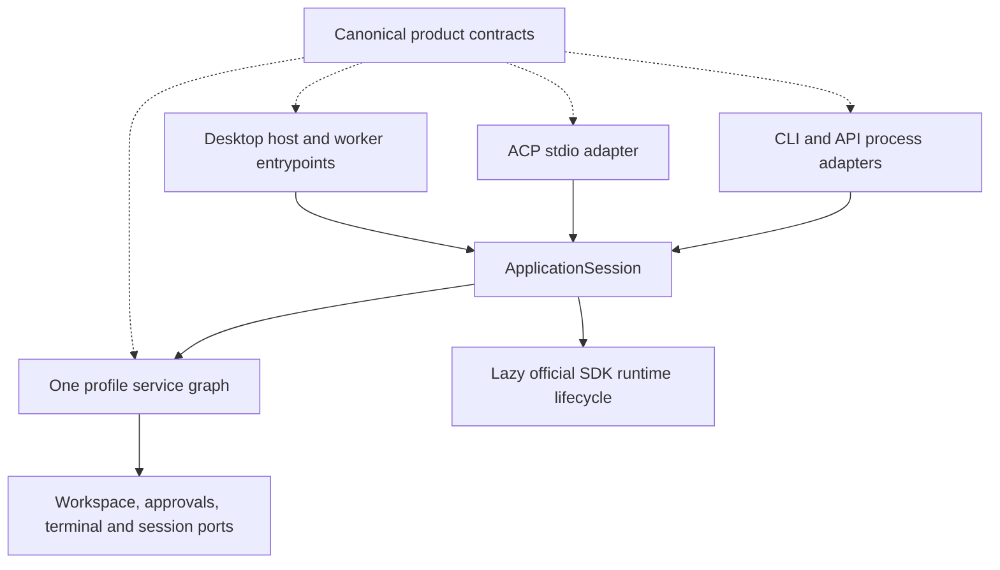

# Architecture

Doolittle owns application composition, clients, transport, workspace access, and
product services. ElizaOS owns the agent runtime, plugin lifecycle, model
inference, credentials, memory, tasks, and coding orchestration. Product adapters
compose those SDK owners rather than implementing a second agent engine.

## Layers and dependency direction

| Layer | Owner | Responsibility |
| --- | --- | --- |
| Process and presentation | `apps/cli`, `apps/desktop` | Stdio, process signals, Electron lifecycle, preload, and UI. |
| Application composition | `packages/agent/src/runtime/application` | One configuration/service graph per application session and lazy SDK runtime activation. |
| Product services | `packages/agent/src/services`, `packages/plugins/doolittle-plugin` | Workspace, conversations, approvals, execution admission, and product projections. |
| Product contracts | `packages/contracts` | Serializable records, identity vocabulary, and boundary guards shared by hosts and clients. |
| Engine and integrations | Official ElizaOS packages | Runtime execution, models, plugins, account stores, SQL, and orchestration. |

Shared packages do not import application source. Browser-safe contracts do not
own Node processes, filesystem access, timers, credentials, or runtime service
instances. Adapters receive explicit ports; avoid incomplete application-context
casts and hidden container properties. Extend existing domain contracts rather
than adding a generic utility, event-bus, or dependency-injection framework.

## Application composition and lifecycle

The [application composition entrypoint](../packages/agent/src/runtime/application/index.ts)
owns configuration, service assembly, and runtime activation. CLI, API, worker,
and ACP entrypoints use this boundary instead of assembling independent service
graphs around the same profile.

A session can expose its product services before model activation. Concurrent
activation requests share the same in-flight activation. The initialized runtime
is bound through an explicit service-assembly port, then handed to the existing
SDK lifecycle and product finalization. Activation failure owns teardown through
the complete initialization boundary; a retry must not abandon a live runtime.
Deferred hydration is distinct from core ownership and can be retried without
constructing a second core graph. Disposal retains ownership until shutdown
settles and prevents a late activation from publishing another live context.

ACP stdio is a transport adapter. The
[protocol host](../packages/agent/src/services/acp/host.ts) consumes narrow ports
for workspace, terminal, approvals, session origins, and turn execution. Its
session and terminal maps survive lazy model activation. The services that
accepted an ACP session are the services used by that session's later turns.

The [shared engine host](../packages/agent/src/runtime/engine/host.ts) starts named
bot worker threads on demand. Each worker has a separate runtime, environment,
and data directory. Threads isolate state, not operating-system authority.
Account selection and host grants remain outside the renderer and worker.

## Canonical product primitives

| Contract | Source | Consumers |
| --- | --- | --- |
| Worker-host protocol | [worker-host.ts](../packages/contracts/src/worker-host.ts) | Desktop host RPC, worker requests, shared-engine transport. |
| Run evidence | [run.ts](../packages/contracts/src/run.ts) | Agent run controller, persistence, desktop transport and status admission. |
| Model routes and catalog | [model-route.ts](../packages/contracts/src/model-route.ts) | Runtime settings, model API, desktop selection, provider adapters. |
| Execution targets and capabilities | [execution.ts](../packages/contracts/src/execution.ts) | Terminal backend selection, admission, previews, and execution records. |

Keep these concepts separate:

- A valid wire envelope is not an authorized operation.
- A runtime run status is not a presentation state.
- A configured model route is not usable authentication or a verified live model.
- A promise deadline is not process cancellation.
- An execution target name is not proof that a backend or capability is available.

### Worker-host protocol

One vocabulary defines operation names, request/response envelopes, UUID request
identity, sequence fields, and capacity/byte limits. Every transport uses the same
structural guards. Transport owners still attest the bot, enforce framing and
byte budgets, reserve pending requests, and match response sequences.

Host authorization remains at the effect boundary. ACK and abandonment retain
receipt ownership and rollback semantics; a late reply cannot establish a new
grant or cross into another bot's pending request. Domain payloads stay untrusted
until their owning operation validates and authorizes them.

### Run evidence

The run controller emits canonical snapshots, status values, local mutation
records, and update events. Desktop records may add routing context such as a bot
ID without redefining the underlying evidence. Persisted receipt guards retain
their explicit shape requirements; a status guard alone is not full validation
of an arbitrary receipt.

[UI host state](../packages/contracts/src/ui-host.ts) is an explicit projection:
for example, cancellation can appear as stopped and pending approval as attention.
Do not create a second execution state machine in presentation. Completion,
cancellation, mutation, and delivery follow runtime receipts rather than view
visibility, timeout, or a successful request submission.

### Model routes

Product providers, SDK model handlers, account bridges, and bootstrap recipes
are different namespaces. For example, `codex`, `codex-cli`, and `openai-codex`
have different responsibilities. Use the canonical identity mapping instead of
copying string tables across clients and plugins.

Saved provider identifiers remain strings so unknown or removed routes stay
visible as unavailable. Only fresh product defaults use `DEFAULT_MODEL_ROUTE`.
Configured provider defaults and discovered model capabilities come from
`/runtime/models`; renderer labels do not define a second model configuration.
Choosing a provider or model never grants access to an account.

### Execution targets

Configured execution resolves to that target or an explicit unavailable result.
It must not silently turn missing remote/container configuration into local
execution. Explicit local operations have their own admission path.

Backends declare supported capabilities; required owned cancellation is admitted
against the actual backend and SDK mode. An accepted `AbortSignal` argument does
not itself establish that underlying work can be stopped. Operations requiring a
bounded cancellation guarantee must refuse an unsupported backend before launch.

The agent's process adapter retains SDK shell routing and provenance. The
independently published provider transport owns its provider child processes,
output capture, and process-tree termination. These are separate physical
lifecycles; they do not become interchangeable by sharing result fields.
Use public SDK deadline primitives for bounded waits while preserving each
owner's cleanup and unconfirmed-outcome behavior.

## Client and workspace authority

The renderer uses the preload transport; the main process checks route, method,
headers, sender, bot, conversation, and project ownership through the
[API policy](../apps/desktop/src/main/ipc/agent-api-policy.ts). A selected folder
or renderer-supplied workspace is a claim, not a grant. Host-confirmed
[project access](../apps/desktop/src/main/bot-project-access.ts) and request-local
runtime scope carry the authorized execution root.

Drafts, streams, queued messages, editor documents, and terminals retain their
conversation owner across presentation changes. Transport errors preserve
uncertain operation state until an authoritative receipt resolves it.

## Workspace responsibilities

The [root workspace index](../README.md#workspaces) links each package's README.
`packages/ui` owns browser presentation; `packages/storage` supplies strict JSON
reads; `packages/characters` and `packages/skills` supply native data. Optional
skills remain in an explicit catalog outside default discovery.

Keep normal SDK persistence and lifecycle ownership upstream. Product state must
surface corrupt or unreadable data rather than replacing it with fabricated
empty state. `vendor/elizaos` contains qualified upstream artifacts;
`tooling/eliza-source` defines how those artifacts are produced. See
[SDK maintenance](sdk.md), [development](development.md), and [testing](testing.md)
for the relevant workflows.
