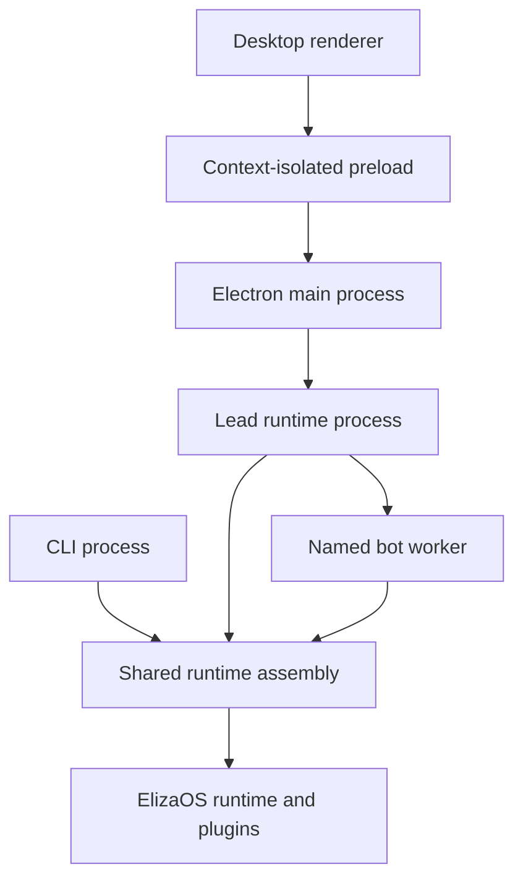

# Architecture

Doolittle is a TypeScript workspace monorepo. ElizaOS owns the agent engine;
Doolittle owns the desktop and terminal clients, transport, and product behavior.

## Workspace map

| Path | Responsibility |
| --- | --- |
| `apps/cli` | Terminal chat, cockpit, commands, API and ACP process entrypoints. |
| `apps/desktop` | Electron main process, context-isolated preload, and React renderer. |
| `packages/agent` | SDK runtime assembly, chat execution, services, API, and gateway. |
| `packages/contracts` | Serializable product contracts and validation shared by clients and runtime. |
| `packages/ui` | Browser-only controls and compositions over Eliza UI primitives. |
| `packages/acp` | Agent Client Protocol adapter using the official protocol SDK. |
| `packages/plugins` | Product plugin source and the remaining provider adapters. |
| `packages/evals` | Workflow fixtures, receipt grading, comparisons, and private reports. |
| `packages/characters` | Character configuration loaded by the runtime. |
| `packages/skills` | Native skill documents, generated metadata, and optional catalog. |
| `packages/storage` | Shared strict JSON reads: only missing files return `null`; corruption and access errors propagate. |
| `packages/solana-layouts` | Compatibility implementation for the upstream Solana layout import. |
| `vendor/elizaos` | Qualified SDK archives, receipts, and materialized upstream workspaces. |
| `tooling/eliza-source` | Pinned inputs and isolated tools for producing those archives. |

The [root manifest](../package.json) defines workspace membership and scripts.
Applications import shared packages through declared exports. Shared packages must
not depend on application source. Avoid root aliases that bypass these boundaries.

## Runtime and client flow

The [engine host](../packages/agent/src/runtime/engine/host.ts) supervises named
bot worker threads. Each bot gets its own runtime and environment. Workers start
on demand; opening a catalog is not permission to start every bot. Worker threads
provide runtime isolation, not an OS security sandbox.

The desktop [bot registry](../apps/desktop/src/main/bot-process-registry.ts) owns
activation and process bindings. Bot, conversation, and project identities must
remain explicit across requests. A UI selection or open folder does not grant
filesystem access. The main process enforces confirmed
[project grants](../apps/desktop/src/main/bot-project-access.ts); request-local
runtime scope carries the authorized root into tools and workers.

The renderer uses the [API client adapter](../apps/desktop/src/renderer/eliza-client.ts)
over the preload transport. The main process validates routes, methods, headers,
and sender ownership through the
[API policy](../apps/desktop/src/main/ipc/agent-api-policy.ts). Tokens and privileged
host capabilities stay outside the renderer. Dedicated streams preserve their
own cancellation and ownership semantics.

## Agent ownership

Ordinary chat enters the SDK message lifecycle. Prefer official SDK services for
model inference, plugins, tasks, memory, credentials, and coding orchestration.
Product-specific projections and workspace tools belong in Doolittle. A service
wrapper must not silently create a competing engine lifecycle.

Actions and context providers are assembled in the
[product registry](../packages/agent/src/runtime/native/plugin-registry/product/index.ts).
Model providers are assembled in the
[provider registry](../packages/agent/src/runtime/native/plugin-registry/providers.ts).
REST adapters live under [server routes](../packages/agent/src/server/routes).

To add behavior:

1. Put its serializable cross-client contract in `packages/contracts` when needed.
2. Implement the action, context provider, service, or route at its owning boundary.
3. Register it in the existing assembly rather than introducing a second dispatcher.
4. Extend a behavior test under `tests/`; exercise real registration when wiring changes.

Doolittle-owned model prompts use the shared
[prompt-cache layer](../packages/agent/src/runtime/prompt-cache/README.md).
SDK-owned prompts retain the SDK's cache policy. User input and credentials must
never be marked as reusable stable context.

## Skills and persistent state

Active skills are direct child directories containing `SKILL.md` under
`packages/skills`. The `.optional/` subtree is an explicit catalog, excluded from
default SDK discovery. `.generated/` contains ignored local bookkeeping.
[Skill conventions](../packages/skills/README.md) describe frontmatter and layout.

Use the SDK's persistence primitives where available. Client-only state readers
may share `packages/storage`; do not turn malformed state into a fabricated empty
state. Never derive completion, cancellation, or delivery from a UI transition;
use the authoritative runtime receipt.

For dependency changes see [SDK maintenance](sdk.md). For verification scopes see
[testing](testing.md).
