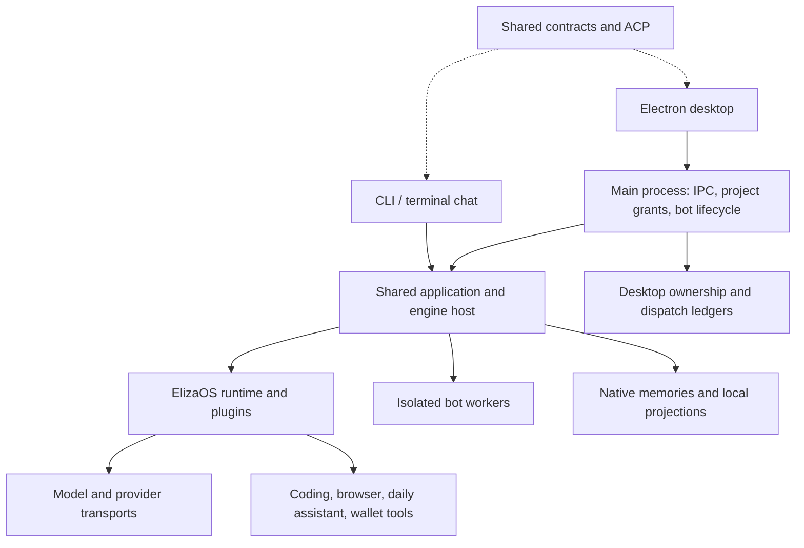

# Doolittle codebase review — October 25, 2026

**What this repo does:** Doolittle supplies desktop and terminal clients for an ElizaOS agent, including coding tools, conversations, background work, account connections, and wallet/trading tools. Both clients share the engine and application services. This review assumes one local operator, several bots and concurrent sessions, and recurring jobs left running for weeks.

## Assessment

This is a substantial, functioning alpha with real monorepo boundaries. It is beyond a prototype, but its current evidence does not establish a dependable replacement for a mature coding assistant across long sessions and every supported platform. The next work should strengthen recovery and long-running operation before adding more surface area.

The workspace map is coherent. `apps/cli` and `apps/desktop` own client entry points. `packages/agent` owns the shared runtime, gateway, services, and terminal experience; `packages/contracts`, `packages/acp`, and `packages/ui` hold shared interfaces and client building blocks. Provider bridges live under `packages/plugins`; evaluation tooling has its own workspace. The monorepo checker enforces declared workspace dependencies, exports, import boundaries, and cycles. These are executable rules, not just a folder convention.

### What is strong

- **One engine for both clients.** CLI and desktop converge on the shared application and ElizaOS engine host. Doolittle is not maintaining two independent agents.
- **Ownership is taken seriously.** Bot/session attribution, explicit workspace approval, request scopes, worker admission limits, and durable dispatch identities have concrete implementations and tests. Historical conversation data is not automatically treated as filesystem consent.
- **Failure is usually explicit.** Conflicting ledger copies, missing capabilities, unavailable tools, and unsupported execution paths are refused or labeled. Native capability reporting distinguishes a working transport from a verified capability.
- **Release controls are substantial.** CI checks types, boundaries, documentation, dependencies, source workers, native Electron behavior, and clean-HEAD packaged acceptance. Release workflows also handle provenance and platform packaging.
- **The development loop is usable.** The desktop watcher rebuilds and restarts its own main process/runtime; the renderer uses hot reload. Testing changes does not require reinstalling the desktop app.
- **Evaluation is more than a model saying it succeeded.** Coding evaluation inspects mutation, build, runtime, and handoff receipts. Live client checks verify a repaired source fixture externally. These are useful foundations, although they cover much less than the full product promise.

### What changed in this pass

Three focused commits address real persistence problems:

1. Seven desktop state readers now reuse the existing bounded regular-file reader. Limits apply before allocating the entire file; symlinked primary files are rejected and supported backup recovery is preserved.
2. Bot catalog changes become visible only after their durable write succeeds. JSON size budgets now measure the actual pretty-printed on-disk representation; conversation writes also enforce their read budget before replacing either copy.
3. Automation and consultation ledger parsers accept canonical native Windows workspace paths. They previously accepted such records on write and rejected them on reload.

The new regression cases were run against the old behavior first. Seven unsafe-read cases, four failed-catalog-publication cases, and two Windows-path cases failed before their fixes. Additional tests cover valid reads, backup recovery, and the serialized-size boundary. The Windows-path tests emulate native path semantics on macOS; they are not a native Windows acceptance run.

## Must fix

1. **Recurring desktop jobs eventually exhaust a permanent dispatch history** (`apps/desktop/src/main/bot-automation-ledger.ts:156`, `apps/desktop/src/main/bot-automation-ledger.ts:209`).
   - **What this is:** The desktop records each target-bot automation dispatch before submitting it, preserving identity and duplicate prevention across restarts.
   - **Problem:** The ledger refuses more than 5,000 fires or 8 MB, and has no retention or archival operation. A five-minute recurring job reaches 5,000 fires in about 17.4 days; the byte limit can arrive sooner, and completed records remain in the same array.
   - **Fix:** Add explicit archival of terminal records while preserving the durable duplicate-prevention contract. Keep active records and a compact, bounded replay history; define when an old fire identity can no longer be replayed before deleting it.
   - **If we skip it:** A normal long-running assistant eventually stops admitting new target-bot jobs and needs manual state intervention. Refusing the run is safer than losing its identity, but it is still an operational failure.

## Should fix

2. **Conversation replacement needs direct recovery tests** (`packages/agent/src/runtime/chat-turn/conversation-persistence.ts:769`).
   - **What this is:** Context replacement writes an Eliza summary, snapshots and deletes replaced native memories, then lets the caller update the local conversation projection. Compensation restores the old state when a step fails.
   - **Problem:** The maintained test tree does not directly exercise the replacement/replay rollback helpers. A failure after some native deletions, or a failure updating the projection after native success, is a high-cost history-consistency case left without a focused regression journey.
   - **Fix:** Add failure-injection tests around a real conversation replacement: summary write failure, partial deletion failure, projection failure, and failed compensation. Assert both authorities after restart and check that an incomplete rollback is reported.
   - **If we skip it:** Ordinary chat tests can stay green while a rare compression or replay failure damages a user's recoverable history. This is a coverage gap, not a reproduced data-loss incident.

3. **Provider CLI output has no memory budget** (`packages/plugins/provider-transport/src/command.ts:136`).
   - **What this is:** Claude and Devin inference bridges collect child-process stdout and stderr until exit or timeout.
   - **Problem:** Both streams append to strings without a byte limit. A faulty or very noisy provider can emit hundreds of megabytes before its 120-second invocation deadline; the deadline does not bound memory consumption.
   - **Fix:** Count combined output bytes, terminate the owned process when a documented response budget is exceeded, and return a bounded diagnostic. Add a subprocess test that exceeds the limit on each stream.
   - **If we skip it:** A broken provider can exhaust a worker's memory or force large allocations while reporting an error. This finding comes from the implementation; no out-of-memory stress run was performed.

4. **Windows provider cancellation only kills the immediate child** (`packages/plugins/provider-transport/src/command.ts:46`).
   - **What this is:** The shared provider runner attempts to terminate its process tree on cancellation or deadline.
   - **Problem:** POSIX launches a separate process group and kills that group. On Windows it calls only `child.kill()`, which does not terminate descendant processes; a provider launcher that starts a worker can leave that worker running and inherited pipes open after timeout.
   - **Fix:** Use an owned Windows process-tree termination mechanism and test a launcher with a child that holds stdout open. Assert that cancellation settles and both owned processes stop.
   - **If we skip it:** A Windows inference request may outlive its deadline or leave provider work running after the user cancels. This is a source-level platform finding, not a reproduced Windows failure.

## Dependency and maintenance position

The fresh production audit covers 38 locked dependency roots and 1,739 lockfile packages and reports **zero advisories at every severity**. That is a good current result, not a guarantee against unpublished defects or future advisories.

The goal of a patch-free dependency tree is **not complete**. Seven package patches and three declared SDK compatibility workspaces remain. Their ownership and upstream requirements are documented in [SDK package upgrades](sdk-package-upgrades.md). Core compatibility remains on `2.0.3-beta.7`; independently usable packages have explicit newer versions. Removing these patches without replacement behavior would weaken state safety, tool ownership, or retained wallet functionality.

The large composition files remain a maintenance cost: desktop `ChatPage.tsx`, `App.tsx`, and the bot process registry carry substantial lifecycle and coordination logic. Their size alone is not a bug. Future extraction should follow ownership boundaries such as run-event recovery or worker lifecycle, with a behavior test before moving code. Another wholesale rewrite would add risk without addressing the concrete findings above.

The review map counted approximately 295,000 TypeScript/JavaScript source and test lines in 2,246 files at the starting revision, excluding generated outputs and installed dependencies. This is a large product for a local assistant. Keep the architecture checks and narrow commits; do not treat a clean folder layout as evidence that the runtime is simple.

## Verification in this pass

- All tooling and workspace type checks: passed.
- Fast boundary suite: **159 tests in 28 files passed**.
- Formatting/lint: passed.
- Monorepo, hygiene, workflow security, plugin boundaries, SDK declarations, documentation truth, local links, unused dependencies: passed.
- Production advisory policy: passed, zero advisories at every severity.
- Source-worker acceptance: **7 tests in 3 files passed**.
- Native desktop workbench: **4 tests passed**, covering first chat, grants across restart, denied cross-bot/root access, and stable catalog polling.
- Live coding: **both CLI and desktop passed** against the real linked Codex provider through ElizaOS, with source repair independently verified (38.5 seconds and 43.3 seconds).
- The first Linux CI run failed the fresh-bot composer check at its default five-second assertion timeout; the other three native journeys passed. That journey now waits up to 30 seconds for the independently started bot worker, within its unchanged 60-second overall deadline. It does not retry or skip the assertion.
- Packaged installer/signing acceptance was not rerun locally in this pass. PR CI runs its own packaged acceptance.

## Readiness

| Area                          | Assessment                                                                                                                  |
| ----------------------------- | --------------------------------------------------------------------------------------------------------------------------- |
| Monorepo organization         | Coherent and enforced; preserve the shared engine boundary.                                                                 |
| CLI and desktop               | Real clients with meaningful executable acceptance; full daily-use reliability is not established.                          |
| Security and state boundaries | Strong deliberate controls; this pass corrected several persistence defects. This was not a comprehensive penetration test. |
| Long-running assistance       | Needs dispatch-history retention and stronger recovery evidence.                                                            |
| Wallet/trading                | Retained; this review did not submit transactions or verify trading profitability.                                          |
| Dependencies                  | Fresh production advisory audit clean; seven patches and three compatibility workspaces remain.                             |
| Coding quality                | Real coding canaries and evaluation infrastructure exist; no fresh representative long-task benchmark cohort was run here.  |
| Release status                | Source validation is separate from signed releases, native Windows operation, and installation acceptance.                  |

**Verdict:** A credible working alpha. Fix durable dispatch retention first, then test conversation recovery and harden provider process limits before calling it a dependable daily-driver replacement.

**Not checked:** This was a repo-wide map and risk-based source review, not a line-by-line read of all 2,246 files. Deep inspection concentrated on runtime entry points, worker/server ownership, desktop persistence and project access, conversation persistence, provider process transport, and build/test/release controls. UI routes, service families, ACP, evaluation tooling, and support packages were sampled; native Rust internals were not reviewed; every command, skill document, plugin integration, and UI interaction was not exercised. No full visual/accessibility audit, native Windows/macOS signing assessment, live wallet transaction, multi-day soak, exhaustive malicious-filesystem race test, or representative competitor benchmark was performed. Mutable ancestor-directory replacement is outside the bounded file reader's guarantee.
