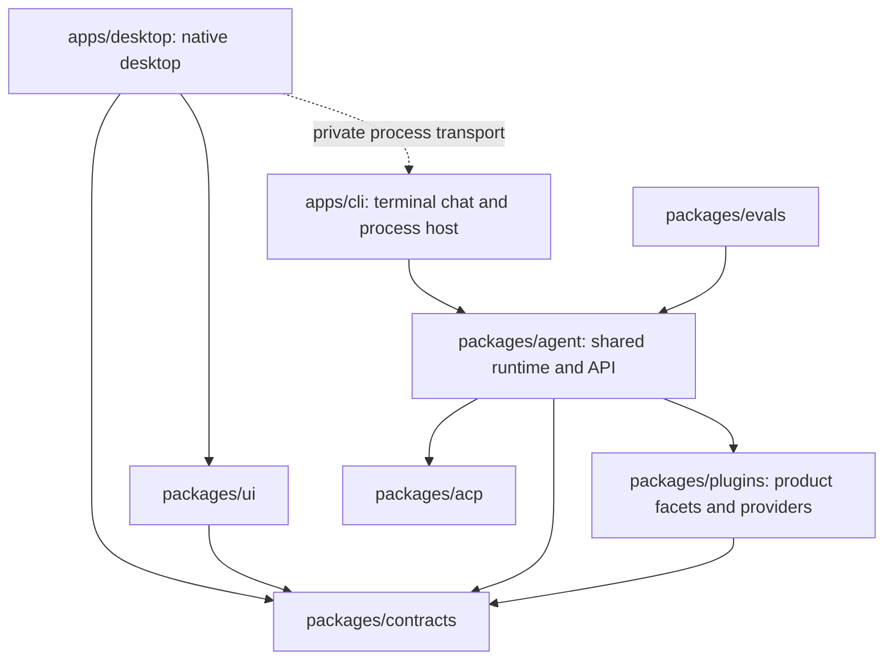

# Monorepo Layout

Doolittle is organized as a Nub workspace monorepo running on stock Node.js.

## Workspace roles

| Workspace                                                                                | Role                                                                                                                                                                                    |
| ---------------------------------------------------------------------------------------- | --------------------------------------------------------------------------------------------------------------------------------------------------------------------------------------- |
| Root package                                                                             | Workspace manifest, exact ElizaOS release contract, shared scripts, documentation, and toolchain configuration.                                                                         |
| `apps/desktop`                                                                           | Electron lifecycle and native capabilities, context-isolated preload contract, and React operator UI. See the [desktop guide](./desktop.md).                                            |
| `apps/cli`                                                                               | Terminal chat, fullscreen cockpit, one-shot commands, background jobs and runtime process entrypoints.                                                                                  |
| `packages/agent`                                                                         | Shared Eliza runtime assembly, API, gateway, product services and optional native utilities.                                                                                            |
| `packages/acp`                                                                           | Agent Client Protocol server and in-process bridge built on the official ACP SDK.                                                                                                       |
| `packages/ui`                                                                            | Browser-only shared presentation components; no runtime or privileged host access.                                                                                                      |
| `packages/evals`                                                                         | Workflow evaluations and evidence reports; depends on the runtime without owning its lifecycle.                                                                                         |
| `packages/contracts`                                                                     | Secret-free contracts shared across the agent, desktop, gateway, and plugins.                                                                                                           |
| `packages/plugins`                                                                       | Doolittle product facets plus the Claude Code and Devin provider bridges. Official Codex, Eliza Cloud, SQL, browser, MCP, messaging, and model plugins remain upstream-owned.           |
| `packages/characters`                                                                    | Character and persona data loaded by Eliza.                                                                                                                                             |
| `packages/skills`                                                                        | Curated and generated native skill documents. See the [skills index](../packages/skills/index.md).                                                                                      |
| `packages/skill-packs-optional`                                                          | Optional native skill documents kept outside the default curated tier.                                                                                                                  |

## Dependency direction



`apps/cli` supplies the executable host for terminal, API, gateway and ACP modes.
The desktop starts its API mode over private process transport; it does not
import the CLI or runtime implementation into the renderer. Source runtime
artifacts live in `apps/cli/dist/`; desktop artifacts live in
`apps/desktop/dist/` and `apps/desktop/build/`.

## Boundary rules

- Applications own their product flows; shared packages cannot depend on apps.
- Use relative imports inside a workspace. Cross-workspace consumers use a
  declared dependency and a declared package export. Root source aliases are
  removed, and relative imports cannot bypass another workspace's public API.
- `packages/agent` owns runtime assembly, API, gateway and shared product services.
  `packages/plugins` owns product plugin facets and provider bridges; prefer
  official ElizaOS SDK primitives for runtime lifecycles.
- The root owns orchestration, development tools, release policy and documentation.
  Production runtime dependencies are declared by the runtime workspace.
- `tsconfig.base.json` holds common compiler rules. Each code workspace has its
  own typecheck; root `typecheck` checks tooling and every code workspace.
- `check:monorepo` verifies dependency declarations, package exports, source
  ownership and an acyclic dependency graph. It runs in CI's acceptance gate.
- `knip:deps` audits the entire workspace set, including the CLI and repository
  scripts. Its root exceptions are the optional ScriptC compiler and the SDK
  SQL packages provisioned for upstream resolution and packaging.
  Unused unpublished SDK branches are excluded; no local SDK namespace packages remain.

See the [module structure guidelines](./module-structure-guidelines.md) for
folder, filename, entrypoint, and test-placement conventions.

## Validation

Run the workspace quality pass from the repo root:

```bash
nub run check
nub run check:monorepo
nub run check:acceptance
nub run check:runtime-advisory-policy
```

Production audit commands project all declared workspace production roots into
isolated importer views of the existing lockfile. They preserve its exact
package snapshots and never install or resolve new versions. The audit refuses
an empty graph, so a tooling-only root cannot silently remove runtime coverage.
New advisory IDs, ranges or severities still fail the separate review policy.
See the [October 25 audit follow-up](security/monorepo-audit-2026-10-25.md) for
findings exposed by correcting the audit scope.

## Bootstrap flow

For a fresh clone, use the Nub-powered installer wrapper:

```bash
bash scripts/install.sh
```

That script installs workspace dependencies, creates `.env` from `.env.example` if needed, and seeds the local runtime directories under `.doolittle/`.

If you only need the bootstrap step again:

```bash
nub run bootstrap
```

Useful workspace commands:

```bash
nub run workspace:list
nub run lint:check
nub run typecheck
nub run test
nub run build
nub run native:verify
```

See [Doolittle native tools](./native-tools.md) for the stricter ownership and
toolchain rules applied to native compilation.
